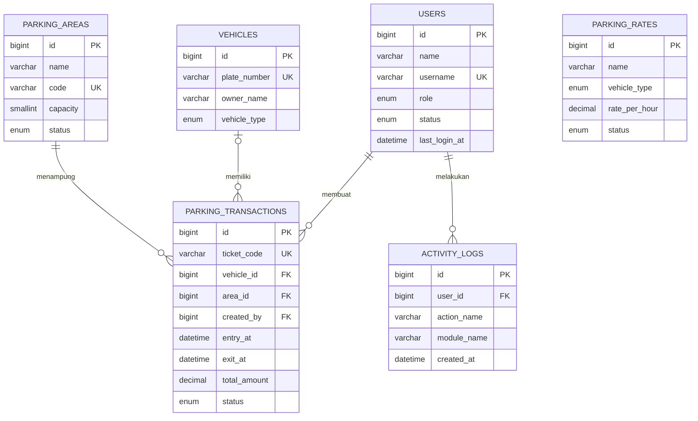

# ERD ParkirKu

Tarif dipisahkan sebagai tabel master karena dapat berkembang menjadi tarif berdasarkan jam, hari, atau jenis layanan tanpa mengubah tabel transaksi. Nilai `rate_per_hour` dan snapshot plat/jenis kendaraan disalin ke transaksi agar riwayat lama tidak berubah ketika master tarif diedit.
